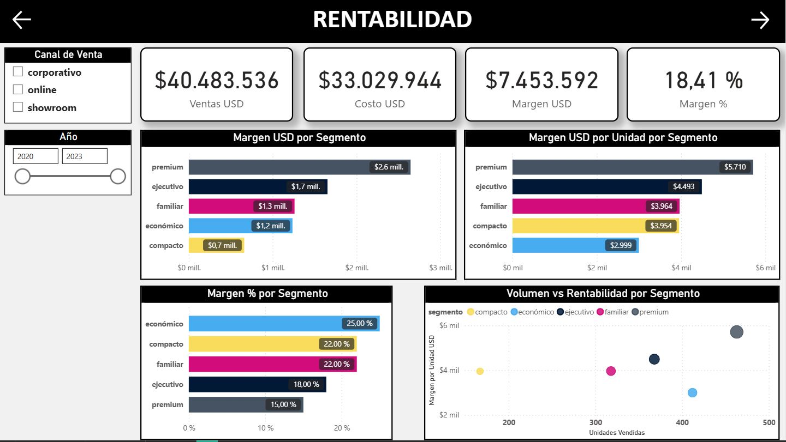

# Análisis de Ventas de Vehículos
Optimización de la Oferta de Vehículos en una Concesionaria - Proyecto de Business Analytics

## Contexto
Una concesionaria de automóviles comercializa distintas configuraciones de vehículos que varían según características como precio, nivel de mantenimiento, cantidad de puertas, capacidad de pasajeros, tamaño del maletero y nivel de seguridad.

Si bien la empresa dispone de múltiples combinaciones de producto, no todas presentan el mismo nivel de aceptación en el mercado ni generan la misma rentabilidad. La organización enfrenta el desafío de gestionar eficientemente su oferta, priorizando aquellas configuraciones que maximicen el rendimiento económico sin afectar la satisfacción del cliente.
## Objetivo
Analizar el desempeño comercial y financiero de las distintas configuraciones de vehículos con el fin de proponer recomendaciones estratégicas que optimicen la rentabilidad de su oferta manteniendo niveles adecuados de aceptación del mercado.
## Herramientas
- Python: limpieza, transformación de datos y análisis exploratorio (EDA) mediante estadísticas descriptivas y visualizaciones.
- SQL: diseño del modelo relacional.
- Power BI: desarrollo de indicadores, medidas DAX y visualizaciones para analizar los resultados.
## Proceso de Trabajo
1. **Preparación de datos:** revisión de la estructura, limpieza y transformación de las variables con Python.
2. **Análisis exploratorio:** análisis de distribuciones, relaciones entre variables y detección de posibles valores atípicos.
3. **Modelado de datos:** organización de la información en tablas relacionales mediante SQL.
4. **Análisis y visualización:** desarrollo de indicadores y un dashboard interactivo en Power BI.
## Código y Documentación
- Notebook de Python: disponible en este repositorio.
- Documentación completa: enlace a tu página de Notion.
## Resultados Principales
El análisis integral del portafolio de vehículos permitió identificar diferencias entre segmentos y configuraciones en términos de volumen de ventas, generación de ingresos y contribución al margen comercial. Los resultados muestran que maximizar las ventas no necesariamente equivale a maximizar la rentabilidad, por lo que resulta importante analizar ambas dimensiones en conjunto. 

El segmento **Premium** lidera en volumen y margen total. Representa aproximadamente el 27 % de las unidades vendidas y genera la mayor contribución al margen total, impulsado por su volumen de comercialización y su margen por unidad.

Los segmentos **Económico**, **Compacto** y **Familiar** presentan mayor margen porcentual. Aunque no lideran en margen total, muestran una mayor eficiencia relativa en la generación de margen por cada dólar vendido.

El segmento **Ejecutivo** mantiene un desempeño equilibrado. Combina un volumen relevante de ventas con niveles competitivos de margen por unidad.

El segmento Compacto presenta oportunidades de revisión. Su menor participación en las ventas y su menor contribución al margen total justifican analizar su posicionamiento y el desempeño de sus configuraciones.

Por último, el análisis a nivel de configuración permitió distinguir productos que combinan alto volumen y margen, alternativas rentables con potencial de crecimiento y configuraciones cuyo desempeño podría requerir ajustes comerciales.

## Dashboard de Power BI

### Desempeño General

### Rentabilidad

### Estrategia de Mix

